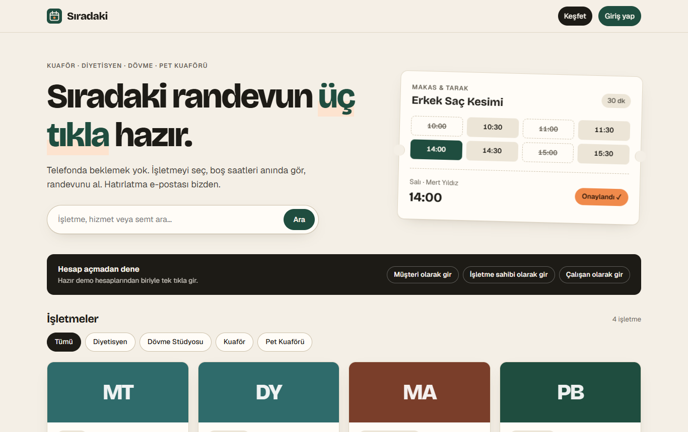
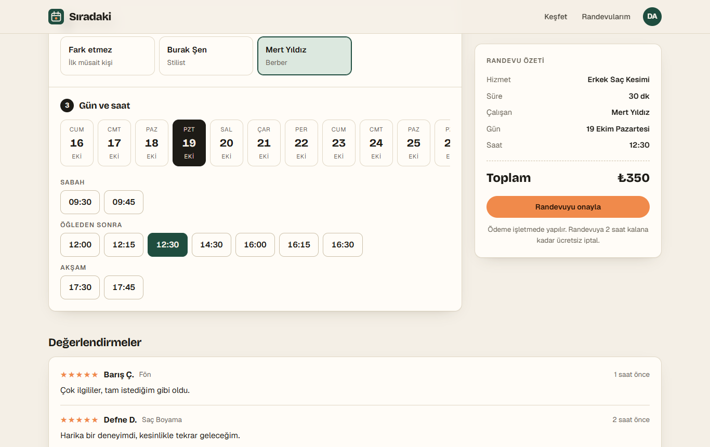
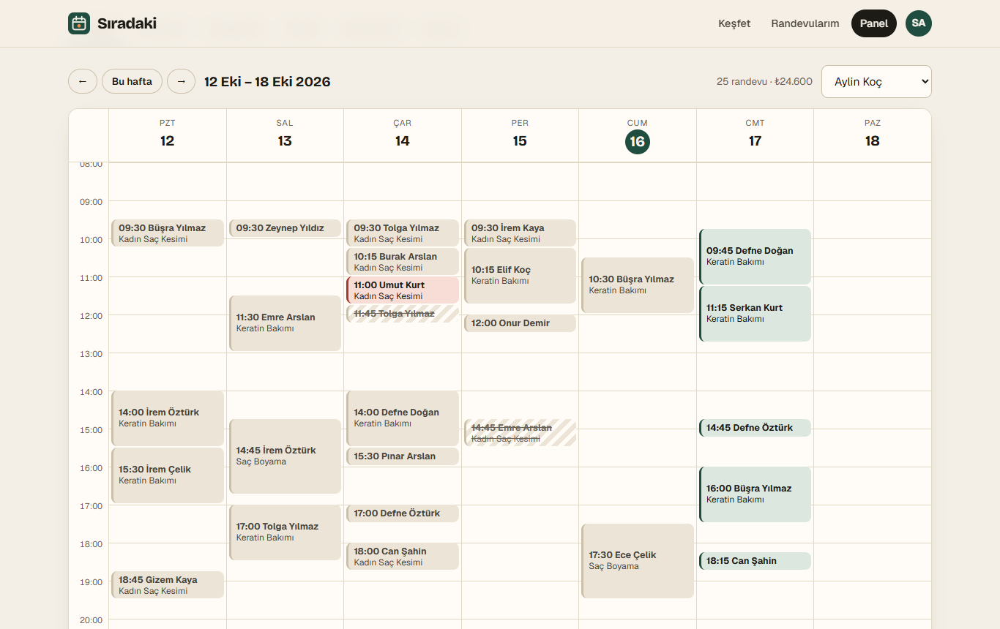
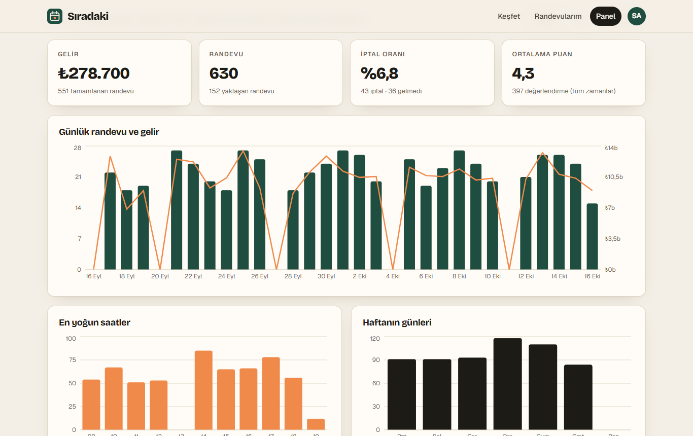

# Sıradaki — multi-business appointment booking

A full-stack booking platform for salons, dietitians, tattoo studios and other appointment-based businesses.
Customers see real free time slots and book in three clicks; owners manage staff, working hours and time off,
watch their calendar update live and read statistics about their business.

[Türkçe README](README.tr.md)



| Booking | Live calendar | Statistics |
|---|---|---|
|  |  |  |

## What makes it interesting

**Double booking is impossible, not just unlikely.** Two customers clicking the same slot at the same
millisecond both pass any "is it free?" check in application code. Here the database itself refuses the
second row with a PostgreSQL *exclusion constraint* on a time range:

```sql
CONSTRAINT appointments_staff_no_overlap
  EXCLUDE USING gist (staff_id WITH =, period WITH &&) WHERE (status <> 'cancelled')
```

A test fires 10 concurrent booking requests at one slot and asserts that exactly one succeeds
([`api/tests/booking.test.ts`](api/tests/booking.test.ts)). With "any staff member" selected, a
rejected insert simply falls through to the next free person.

**Correct free-slot computation.** Working blocks (lunch break = gap between blocks), time off, existing
appointments and a 30-minute booking lead time are combined with pure interval arithmetic
([`api/src/lib/slots.ts`](api/src/lib/slots.ts)), in the business' own time zone, including
daylight-saving days. Fully unit tested.

**Live calendar across server instances.** A booking transaction ends with `pg_notify(...)`; PostgreSQL
delivers it only if the transaction commits. Every API process `LISTEN`s and pushes the event over a
WebSocket to the owners and staff of that business (staff only receive their own calendar).

**Background jobs that survive restarts.** Confirmation, 24-hours-before reminder and cancellation e-mails
are queued in PostgreSQL with pg-boss and retried with backoff. Handlers are idempotent (a retried reminder
is not sent twice; a reminder for a cancelled appointment is skipped). A demo mailbox shows every sent e-mail.

**Security basics done properly.** argon2id password hashes; random session tokens stored only as SHA-256
hashes; `httpOnly` + `SameSite=Lax` cookies; JSON-only request bodies; rate-limited login; identical errors for
"unknown e-mail" and "wrong password"; role checks on every endpoint (owner / staff / customer); other
people's appointments answer `404`, not `403`.

## Features

- Public business directory with search, categories, ratings and starting prices
- Booking flow: service → staff (or "anyone") → day → free time → confirm
- My appointments: cancel (until 2 h before), review completed visits (1–5 stars)
- Owner panel: weekly calendar (per staff or overview), services, staff & weekly hours editor,
  time off, statistics (revenue, cancellation rate, busiest hours/weekdays, per service / per staff), settings
- Staff panel: own calendar, own time off, mark no-shows
- Demo mailbox and one-click demo logins

## Tech stack

| Layer | Choice |
|---|---|
| API | Node.js 24 (runs TypeScript directly), Fastify 5, Zod |
| Database | PostgreSQL 17, hand-written SQL migrations, Kysely query builder |
| Jobs / realtime | pg-boss, LISTEN/NOTIFY, @fastify/websocket |
| Web | React 19, Vite, React Router, TanStack Query, Recharts, Luxon |
| Tests | Vitest against a real PostgreSQL (54 tests), GitHub Actions |

## Getting started

Requirements: **Node.js 24+**. Nothing else — PostgreSQL is downloaded as an npm package and runs inside
the project folder (`api/.pgdata`), so no installation, admin rights or Docker are needed.

```bash
npm install
npm run setup   # one time: creates the local database (random password in api/.env) and demo data
npm run dev     # database + API (http://localhost:3000) + web app (http://localhost:5173)
```

Open http://localhost:5173 and use one of the one-click demo accounts (password `demo12345`):

| Account | Role |
|---|---|
| `musteri@demo.test` | customer with past and upcoming appointments |
| `isletme@demo.test` | owner of "Makas & Tarak" (3 staff, ~3 months of data) |
| `calisan@demo.test` | staff member (barber) at "Makas & Tarak" |

Other commands:

```bash
npm test          # API test suite (starts its own throw-away PostgreSQL)
npm run typecheck # TypeScript, both packages
npm run build     # production build of the web app (served by the API from web/dist)
npm run seed      # reset demo data (the dev database must be running: npm run db)
```

## Project layout

```
api/
  migrations/001_initial.sql   schema and every database-level rule
  src/
    app.ts                     Fastify setup, error format, static web app
    modules/                   auth, businesses, availability, appointments, stats, notifications, realtime
    lib/                       slots (interval math), access (roles), queue, events, errors
    scripts/                   setup, dev database, migrate, seed
  tests/                       integration + unit tests
web/src/
  pages/                       Home, Business (booking), MyAppointments, Mailbox, Auth, panel/*
  hooks/useLiveAppointments.ts WebSocket with reconnect
docs/tasarim.md                design notes (Turkish)
```

## Deploying

The API serves the built React app, so one Node.js service plus one PostgreSQL database is enough.
Set `DATABASE_URL`, `NODE_ENV=production`, `APP_URL` (and optionally `SMTP_URL`), run `npm ci && npm run build`,
then `npm start`. Migrations run automatically on start. See [`api/.env.example`](api/.env.example).

## License

MIT
