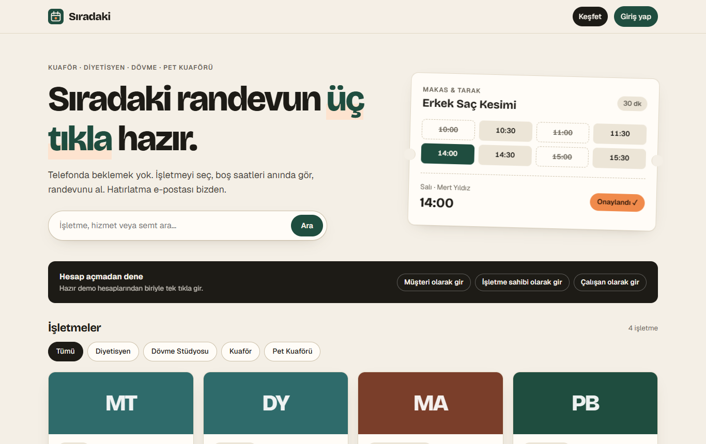

# Sıradaki — çok işletmeli online randevu platformu

Kuaför, diyetisyen, dövme stüdyosu gibi randevuyla çalışan işletmeler için uçtan uca bir web uygulaması.
Müşteri gerçek boş saatleri görür ve üç tıkla randevu alır; işletme sahibi çalışanlarını, çalışma saatlerini
ve izinleri yönetir, takvimini canlı izler, işletmesiyle ilgili istatistikleri görür.

[English README](README.md)



## Öne çıkanlar

- **Çift randevu imkânsız:** Aynı saate aynı anda gelen iki istekten ikincisini PostgreSQL'in kendisi
  *exclusion constraint* (çakışma yasağı) ile reddeder. 10 eşzamanlı istekle yalnızca birinin başarılı olduğu
  testle kanıtlanır.
- **Doğru boş saat hesabı:** Çalışma blokları (öğle arası), izinler, mevcut randevular ve "en erken 30 dk sonra"
  kuralı; işletmenin saat diliminde ve yaz saati geçişlerinde bile doğru hesaplanır.
- **Canlı takvim:** Randevu işlemi `pg_notify` ile biter; PostgreSQL bildirimi yalnızca işlem başarılı olursa
  iletir; sunucu WebSocket ile ilgili işletmenin paneline gönderir.
- **Kalıcı arka plan işleri:** Onay, 24 saat önce hatırlatma ve iptal e-postaları pg-boss kuyruğunda bekler,
  hata olursa yeniden denenir. Demo posta kutusunda görülebilir.
- **Güvenlik:** argon2id şifre özeti, veritabanında yalnızca özeti tutulan oturum tokenı, httpOnly çerez,
  istek sınırlama, her uç noktada rol kontrolü.

## Kurulum

Gereken tek şey **Node.js 24+**. PostgreSQL npm paketi olarak iner ve proje klasörü içinde çalışır;
ayrı kurulum, yönetici izni veya Docker gerekmez.

```bash
npm install
npm run setup   # bir kez: yerel veritabanı (rastgele şifre api/.env içine) + demo verisi
npm run dev     # veritabanı + API (3000) + arayüz (http://localhost:5173)
```

Demo hesapları (şifre `demo12345`): `musteri@demo.test` (müşteri), `isletme@demo.test` (işletme sahibi),
`calisan@demo.test` (çalışan). Giriş sayfasında tek tıkla girilebilir.

Testler: `npm test` (kendi geçici PostgreSQL'ini açar, 54 test).

Ayrıntılı tasarım notları: [docs/tasarim.md](docs/tasarim.md)
